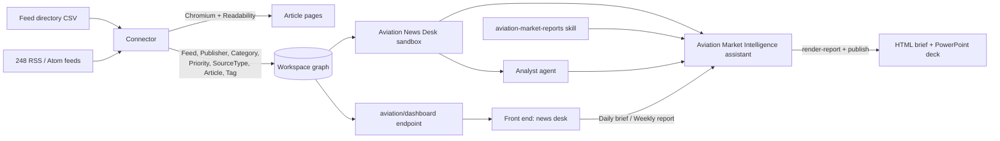

# Aviation Market Intelligence

A Curiosity application that monitors **248 real aviation & aerospace RSS feeds**, reads every new
article in full where the publisher allows it, and turns a day or a week of news into a **daily
brief** or a **weekly market report** - each published as an HTML page and a PowerPoint deck.

Read [`docs/use-case.md`](docs/use-case.md) for the design brief. The repository started from the
Curiosity application template; its guide is in
[`docs/curiosity-application-template.md`](docs/curiosity-application-template.md), and
`sample-application/` is kept as the reference implementation.

| | Where |
| --- | --- |
| Feed directory (real sources) | [`data/feeds/aviation-aerospace-rss-directory.csv`](data/feeds/aviation-aerospace-rss-directory.csv) |
| Connector: RSS + Playwright + Readability | [`src/AviationIntel.Connector/`](src/AviationIntel.Connector) |
| Workspace definitions (sandbox, agent, skill, assistant, endpoint, schemas) | [`src/AviationIntel.Definitions/`](src/AviationIntel.Definitions) |
| Report templates (HTML report, PowerPoint deck) | [`src/AviationIntel.Definitions/templates/`](src/AviationIntel.Definitions/templates) |
| Front end (Transpose + Tesserae) | [`src/AviationIntel.FrontEnd/`](src/AviationIntel.FrontEnd) |
| Offline fixtures (synthetic) | [`tests/fixtures/`](tests/fixtures) |
| Tools | [`tools/`](tools) |

## How it fits together



### 1. The connector

`src/AviationIntel.Connector` is a .NET console app on `Curiosity.Library`:

1. reads the directory CSV (248 feeds, deduplicated by URL);
2. fetches every feed (HTTP first; through headless Chromium when a bot check answers the HTTP
   client with a 403 or a challenge page) and parses RSS/Atom with `CodeHollow.FeedReader`;
3. groups items across feeds by canonical URL (tracking parameters stripped), so a syndicated
   release is **one** article with an edge per feed;
4. consults the hash cache **before** loading any page - an unchanged item costs nothing;
5. loads each new article in **Playwright/Chromium** (images, media and fonts blocked; one page
   at a time per host, with a delay; up to N hosts in parallel) and extracts it with
   **SmartReader** (Readability) from the rendered DOM - the same extractor the workspace's
   `RssTask` uses, but over what a browser sees, which covers client-rendered newsrooms and
   consent walls;
6. chooses the body - page text, the feed's own full text, or the feed summary - and records
   which (`ContentSource`) and why (`ExtractionNote`: paywall, 404, unreachable, too short);
7. writes each `Feed` once with this run's fetch status, and each `Article` once with everything.

```bash
# Real run (schedule it, e.g. hourly)
dotnet run --project src/AviationIntel.Connector -- --root . \
    --endpoint https://<workspace> --token <library token>

# Useful options
--dry-run                 map everything, write nothing
--priority Core           only the Core feeds        --feed <text>   name/category/URL filter
--since-days 7            item window (default 14)   --max-items 50  per feed
--browser-concurrency 4   pages at once              --no-browser    feed text only
--chromium <path>         an existing Chromium (or CHROMIUM_PATH); default: Playwright's own
--reset-cache             forget what was ingested
--emit-frontend-schema src/AviationIntel.FrontEnd/src/Schema/N.cs
```

Install Playwright's browser once with `dotnet run --project src/AviationIntel.Connector -- --install-browser`,
or point `--chromium` at an existing Chromium. The connector honours `HTTPS_PROXY` for both the
HTTP client and the browser.

### 2. The workspace definitions

Imported with `python3 tools/import_definitions.py --endpoint <url>` **after the first connector
run**, because the code compiles against the `N`/`E` constants the workspace generates from the
schema the connector registers. Every file is the workspace's own export, byte for byte.

| Definition | What it is |
| --- | --- |
| `code/chat-ai-tools/AVsandboX1111111111111.cs` | **Aviation News Desk** - an `ISandbox`: `/news` (lazy, by day: `README.md`, `index.tsv`, `days/<date>/<uid>.md`), `/feeds` (`directory.tsv` with fetch health, one file per feed), `/templates`, `/work`, `/artifacts`; commands `news`, `article`, `stats`, `render-report`, `search`, `consult`; graph `query` over the seven aviation types |
| `code/skills/aviation-market-reports-*.md` | The editorial method for the daily brief and the weekly report, and the render/publish workflow |
| `code/agents/aviation-market-intelligence-analyst-*.cs` | **Aviation Market Intelligence Analyst** - writes a report end to end |
| `code/ai-assistants/aviation-market-intelligence-*.cs` | **Aviation Market Intelligence** - the sandbox, search, consult, the agent and the skill |
| `code/endpoints/aviation/dashboard.cs` | The home page's live numbers, each with the UIDs it counted |
| `config/schemas/` | The seven node schemas, the edges, and node styles |

### 3. The report templates

`templates/report.html` and `templates/deck.html` both render from **one report JSON** whose
contract is `templates/README.md`. The agent writes data, never HTML:

```bash
stats --since 1d                                  # numbers for metrics, charts, coverage
news --since 1d --priority Core                   # scan
article <uid> ...                                 # read what will be cited
cat > /work/daily.json <<'EOF' ... EOF            # write the report
render-report report /work/daily.json             # HTML brief  -> /artifacts
render-report deck   /work/daily.json             # PowerPoint  -> /artifacts
publish <name>.html                               # show it in the chat
```

`render-report` refuses a report with a missing headline, an item without a "so what", or an
item without a source URL. The deck page builds a native `.pptx` (editable text, charts and
tables) with the workspace's PptxGenJS and hands it over from a download button. A delegated
agent run cannot publish, so its render lands in its own `/agents/...` directory and the
assistant publishes it.

Edit a template, preview it, then run `python3 tools/embed_templates.py` to splice it into the
sandbox tool.

### 4. The front end

`#/` is the news desk: **Daily brief** and **Weekly report** (open a chat on the assistant with the
request), tiles for the last 24 hours / 7 days / feed health / summary-only articles - each opens
exactly the articles it counted (`#/news?set=...`) - the week by category, articles per day, and
the latest news. `#/feeds` is the directory, faceted by category, priority, source type and
publisher. Every node type has a renderer.

## Running it locally against a live server

See [`docs/running-locally.md`](docs/running-locally.md) - building Curiosity from source,
ingesting (from the real feeds or the offline fixtures), importing the definitions, serving this
front end, and exercising the sandbox and the agent without an LLM key.
