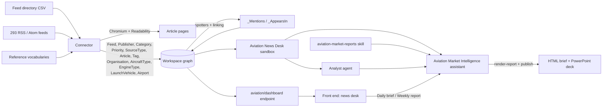

# Aviation Market Intelligence

A Curiosity application that monitors **293 real aviation & aerospace RSS feeds**, reads every new
article in full where the publisher allows it, and turns a day or a week of news into a **daily
brief** or a **weekly market report** - each published as an HTML page and a PowerPoint deck.

Read [`docs/use-case.md`](docs/use-case.md) for the design brief. The repository started from the
Curiosity application template; its guide is in
[`docs/curiosity-application-template.md`](docs/curiosity-application-template.md), and
`sample-application/` is kept as the reference implementation.

| | Where |
| --- | --- |
| Feed directory (real sources) | [`data/feeds/aviation-aerospace-rss-directory.csv`](data/feeds/aviation-aerospace-rss-directory.csv) |
| Entity vocabularies (Wikidata, OurAirports) | [`data/reference/`](data/reference) |
| Connector: RSS + Playwright + Readability | [`src/AviationIntel.Connector/`](src/AviationIntel.Connector) |
| In-workspace connectors (scheduled, run inside the server) | [`src/AviationIntel.Definitions/code/data-connector-tasks/`](src/AviationIntel.Definitions/code/data-connector-tasks) |
| Workspace definitions (sandbox, agent, skill, assistant, endpoint, schemas) | [`src/AviationIntel.Definitions/`](src/AviationIntel.Definitions) |
| Report templates (HTML report, PowerPoint deck) | [`src/AviationIntel.Definitions/templates/`](src/AviationIntel.Definitions/templates) |
| Front end (Transpose + Tesserae) | [`src/AviationIntel.FrontEnd/`](src/AviationIntel.FrontEnd) |
| Offline fixtures (synthetic) | [`tests/fixtures/`](tests/fixtures) |
| Tools | [`tools/`](tools) |

## How it fits together



### 1. The connector

`src/AviationIntel.Connector` is a .NET console app on `Curiosity.Library`:

0. writes the five entity vocabularies from `data/reference/` - organisations, aircraft types,
   engine types, launch vehicles, airports - with every spottable term as an alias, and only the
   relationships their source states (who builds what, which engine powers which aircraft);
1. reads the directory CSV (293 feeds, deduplicated by URL);
2. fetches every feed (HTTP first; through headless Chromium when a bot check answers the HTTP
   client with a 403 or a challenge page) and parses RSS/Atom with `CodeHollow.FeedReader`;
3. groups items across feeds by canonical URL (tracking parameters stripped), so a syndicated
   release is **one** article with an edge per feed;
4. consults the hash cache **before** loading any page - an unchanged item costs nothing;
5. loads each new article in **Playwright/Chromium** (images, media and fonts blocked; one page
   at a time per host, with a delay; hosts interleaved so up to N load in parallel) and extracts
   it with **SmartReader** (Readability) from the rendered DOM - the same extractor the
   workspace's `RssTask` uses, but over what a browser sees, which covers client-rendered
   newsrooms and consent walls. A page the browser is refused (several publishers turn away
   headless Chromium) gets one plain request that identifies the connector by name; a feed
   service's click tracker (follow.it) is followed to the article it names;
6. chooses the body - page text, the feed's own full text, or the feed summary - and records
   which (`ContentSource`) and why (`ExtractionNote`: paywall, 404, unreachable, too short);
7. writes each `Feed` once with this run's fetch status, and each `Article` once with everything,
   100 articles at a time - each batch committed, then recorded in the cache, so a run that dies
   keeps what it read. A page that failed transiently is not recorded, so the next run retries it.

The connector never links an article to a company, aircraft or airport: that is entity linking's
job in the workspace (below).

```bash
# Real run (schedule it, e.g. hourly)
dotnet run --project src/AviationIntel.Connector -- --root . \
    --endpoint https://<workspace> --token <library token>

# Useful options
--dry-run                 map everything, write nothing
--priority Core           only the Core feeds        --feed <text>   name/category/URL filter
--since-days 7            item window (default 14)   --max-items 50  per feed
--browser-concurrency 4   pages at once              --no-browser    feed text only
--chromium <path>         an existing Chromium (or CHROMIUM_PATH); default: Playwright's own
--reset-cache             forget what was ingested   --skip-reference  leave the vocabularies alone
--emit-frontend-schema src/AviationIntel.FrontEnd/src/Schema/N.cs
```

Install Playwright's browser once with `dotnet run --project src/AviationIntel.Connector -- --install-browser`,
or point `--chromium` at an existing Chromium. The connector honours `HTTPS_PROXY` for both the
HTTP client and the browser.

### 1.1 The same connectors, inside the workspace

The connector also exists as two **in-workspace data connectors** - scheduled tasks marked
`[task: Curiosity.Tasks.Connector]` whose C# runs inside the Curiosity server, write through the
same connector API (`Curiosity.Library.ConnectorGraph`, applied in-process) and show up under
Manage → Data → Connector Runs. They travel with the definitions, so importing the definitions is
all a workspace needs to keep its corpus current with no machine of its own:

| Task | Schedule | Port of |
| --- | --- | --- |
| `aviation-rss-feeds-AVconnRSS1111111111111.cs` - **Aviation RSS feeds** | hourly, at :17 | `FeedDirectoryIngest` + `FeedFetcher` + `ArticlesIngest` |
| `aviation-reference-vocabularies-AVconnRef1111111111111.cs` - **Aviation reference vocabularies** | Mondays 04:41 UTC | `ReferenceIngest` |

What differs, and why:

- **No browser.** The server has no Chromium, so article pages are read with one plain HTTP
  request and Readability (SmartReader, which the server ships). A page that renders its body
  with JavaScript or sits behind a bot check falls back to the feed's text, and says so in
  `ContentSource` / `ExtractionNote`. Feeds are parsed with LINQ to XML (RSS 2.0, RSS 1.0, Atom);
  `CodeHollow.FeedReader` is not available to workspace code.
- **No hash cache.** An article already in the workspace is never re-read or re-written - only
  linked to a feed that newly carries it - so whatever the stand-alone connector extracted with a
  browser is kept. A page that failed transiently is marked `(retried next run)` and read again.
  Article keys are canonicalised identically, so both connectors write the same node.
- **The inputs are workspace files.** The feed directory and the vocabularies are uploaded once
  with `dotnet run --project src/AviationIntel.Connector -- --upload-data --endpoint <url> --token
  <library token>` (private files, fixed identifiers; a file's UID is a hash of its identifier, so
  the tasks find them in any workspace). Re-run it after changing anything under `data/`.
- **Aliases are cleared and re-added** each run, which replaces the stand-alone connector's terms
  ledger.

The stand-alone connector remains the better choice for a first full ingest (it reads more pages);
the in-workspace one keeps the corpus current. Their dry runs (Manage → Data → the task → Dry Run,
or `POST /api/scheduling/data-connector/dry-run`) read 5 feeds and 10 pages and write nothing.

### 2. The workspace definitions

Imported with `python3 tools/import_definitions.py --endpoint <url>` **after the first connector
run** (or, on a fresh workspace, after the schemas exist - they are in `config/schemas/`), because the code compiles against the `N`/`E` constants the workspace generates from the
schema the connector registers. Every file is the workspace's own export, byte for byte.

| Definition | What it is |
| --- | --- |
| `code/chat-ai-tools/AVsandboX1111111111111.cs` | **Aviation News Desk** - an `ISandbox`: `/news` (lazy, by day: `README.md`, `index.tsv`, `days/<date>/<uid>.md`), `/feeds` (`directory.tsv` with fetch health, one file per feed), `/templates`, `/work`, `/artifacts`; commands `news` (with `--mentions <entity>`), `article` (lists the entities it mentions), `stats` (with `top_mentions`), `render-report`, `search`, `consult`; graph `query` over the twelve aviation types |
| `code/skills/aviation-market-reports-*.md` | The editorial method for the daily brief and the weekly report, and the render/publish workflow |
| `code/agents/aviation-market-intelligence-analyst-*.cs` | **Aviation Market Intelligence Analyst** - writes a report end to end |
| `code/ai-assistants/aviation-market-intelligence-*.cs` | **Aviation Market Intelligence** - the sandbox, search, consult, the agent and the skill |
| `code/endpoints/aviation/dashboard.cs` | The home page's live numbers, each with the UIDs it counted |
| `config/schemas/` | The twelve node schemas, the edges, and node styles |
| `nlp/` | Entity recognition: five spotters (one per vocabulary), the `Aviation-Entities` pipeline, and the linking rules for `Article.Title` and `Article.Body` |
| `config/pipeline-mapping.json`, `config/indexes/` | Which pipeline parses which article field, and the parser indexes that run it |
| `config/interface.json` | Workspace interface settings: Contacts, Inbox, Calendar and Notes are off |
| `code/data-connector-tasks/` | The two in-workspace connectors (§1.1) |

### 3. The report templates

`templates/report.html` and `templates/deck.html` both render from **one report JSON** whose
contract is `templates/README.md`. The agent writes data, never HTML:

```bash
stats --since 1d                                  # numbers for metrics, charts, coverage
news --since 1d --priority Core                   # scan
article <uid> ...                                 # read what will be cited
cat > /work/daily.json <<'EOF' ... EOF            # write the report
render-report report /work/daily.json             # HTML brief  -> /artifacts
render-report deck   /work/daily.json             # PowerPoint  -> /artifacts
publish <name>.html                               # show it in the chat
```

`render-report` refuses a report with a missing headline, an item without a "so what", or an
item without a source URL. The deck page builds a native `.pptx` (editable text, charts and
tables) with the workspace's PptxGenJS and hands it over from a download button. A delegated
agent run cannot publish, so its render lands in its own `/agents/...` directory and the
assistant publishes it.

Edit a template, preview it, then run `python3 tools/embed_templates.py` to splice it into the
sandbox tool.

### 4. The front end

`#/` is the news desk: **Daily brief** and **Weekly report** (open a chat on the assistant with the
request), tiles for the last 24 hours / 7 days / feed health / summary-only articles - each opens
exactly the articles it counted (`#/news?set=...`) - the week by category, articles per day, and
the latest news. `#/feeds` is the directory, faceted by category, priority, source type and
publisher. The chat page is pinned to the Aviation Market Intelligence assistant with its tools
and agent, and parses every reply against the entity pipeline so the companies, aircraft and
airports it names open beside the conversation. Every node type has a renderer; an article card
shows the entities it mentions.

### 5. Entity recognition

The workspace spots organisations, aircraft types, engine types, launch vehicles and airports in
every article's title and body, from master lists generated from Wikidata and OurAirports by
`tools/build_reference_vocabularies.py` ([`data/reference/README.md`](data/reference/README.md)
has the rules that keep the terms precise). Each spotter is built from the entity's key with its
aliases, case-sensitive, so what is found is exactly the `Terms` column. Linking writes
`_Mentions` (article → entity) and `_AppearsIn` (entity → article); the sandbox's
`news --mentions` and `stats`' `top_mentions`, the article cards and every entity's own page read
them.

## Deploying to a hosted workspace

See [`docs/running-locally.md`](docs/running-locally.md) §5 - the front end is built locally and
uploaded with `curiosity-cli upload-front-end`, the definitions with `tools/import_definitions.py`,
and the connector data with `--upload-data`.

## Running it locally against a live server

See [`docs/running-locally.md`](docs/running-locally.md) - building Curiosity from source,
ingesting (from the real feeds or the offline fixtures), importing the definitions, serving this
front end, and exercising the sandbox and the agent without an LLM key.
